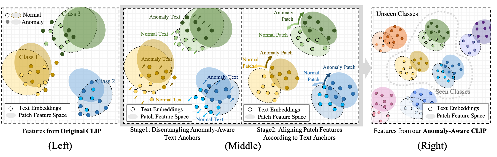
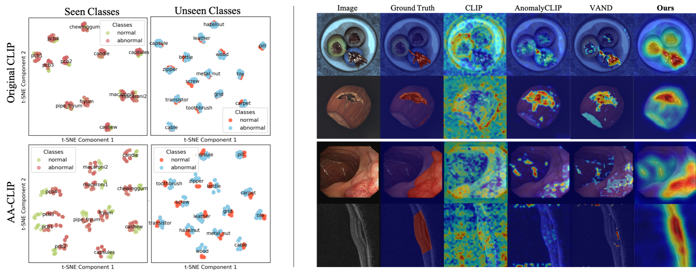

# AA-CLIP: Enhancing Zero-shot Anomaly Detection via Anomaly-Aware CLIP
 **[CVPR 2025 paper]**

[](https://arxiv.org/pdf/2503.06661) [](https://drive.google.com/file/d/1PQrjCvWDyuM7W2ClJ-cJeD4YKJ1uPAzc/view?usp=drive_link)
 Official Pytorch Implementation

本仓库基于 [AA-CLIP 官方实现](https://github.com/Mwxinnn/AA-CLIP)，增加 wafer 少样本数据流程、运行修复、阈值校准和缺陷画框。保留原项目来源及许可证。
GitHub 源码不包含数据集、CLIP 主模型、训练适配器、本地 Python 环境或预测结果。克隆后请安装依赖、准备 `model/ViT-L-14-336px.pt`，并按 [WAFER_GUIDE.md](WAFER_GUIDE.md) 准备自己的数据。
文中的 bottle 权重和本机验证输出是开发记录，需要自行生成；不随仓库下载。

## Wafer 少样本缺陷检测

晶圆表面／显微镜照片的训练与数据标注步骤见 [WAFER_GUIDE.md](WAFER_GUIDE.md)。
当前入口支持正常／异常二分类、像素定位，以及在原图绘制缺陷框并导出 JSON 坐标。
先准备正常图片、异常图片与对齐的二值缺陷 mask，再进行两阶段训练和独立验证集阈值校准。
`custom_infer.py` 和 `web_infer_app.py` 共用画框流程；`--device auto` 自动选择 CUDA、Apple MPS 或 CPU。
已有 bottle 数据和权重用于验证程序流程；wafer 效果需要用自己的数据训练并独立评估。

本次 macOS 环境为 `.venv/bin/python`，后续 Windows 章节中的 `.AA-CLIP` 路径按自己的环境替换。
`requirements-lock-macos.txt` 记录本次 macOS ARM64 / Python 3.12 验证环境的依赖版本。



## Windows 本地使用（.AA-CLIP）

本地已验证的入口为 `train.py`（两阶段小样本训练）、`test.py`（独立测试）、
`custom_infer.py`（单图/目录预测）、`web_infer_app.py`（网页预测）。`home.py` 只是原来的界面占位程序。

### 环境与权重

在项目根目录的 PowerShell 中运行，所有命令都使用指定的 `.AA-CLIP`，无需激活环境：

```powershell
.\.AA-CLIP\Scripts\python.exe -m pip install -r requirements.txt
.\.AA-CLIP\Scripts\python.exe -c "import torch; print(torch.__version__); print(torch.cuda.is_available())"
```

当前实测环境：Python 3.12.1、PyTorch 2.10.0+cu128、RTX 2060 6GB。
主模型为 `model/ViT-L-14-336px.pt`，已从 [OpenAI CLIP 官方权重地址](https://github.com/openai/CLIP/blob/main/clip/clip.py)下载并校验。
SHA256 为 `3035c92b350959924f9f00213499208652fc7ea050643e8b385c2dac08641f02`。
原来的 `ViT-B-32.pt` 不能与本项目 ViT-L/14 适配器混用。

### 直接预测

```powershell
# 使用本次训练的 8-shot 模型；自动读取训练分辨率和验证集阈值
.\.AA-CLIP\Scripts\python.exe custom_infer.py --save_path ckpt/bottle_8shot --image data/opencvxuetang/unknown/small_bad.png --class_name bottle --output results/bottle_8shot

# 整个文件夹批量预测
.\.AA-CLIP\Scripts\python.exe custom_infer.py --save_path ckpt/bottle_8shot --image data/opencvxuetang/unknown --class_name bottle --output results/bottle_8shot

# 网页上传图片；本地浏览器打开启动时打印的地址
.\.AA-CLIP\Scripts\python.exe web_infer_app.py --save_path ckpt/bottle_8shot

# 原有 baseline 权重也可用于预测演示，默认分辨率 518
.\.AA-CLIP\Scripts\python.exe custom_infer.py --save_path ckpt/baseline --image data/opencvxuetang/unknown/small_bad.png --output results/baseline_check
```

结果包含原图大小的 `_overlay.png` 缺陷叠加图、`_heatmap.png` 热力图、
`_raw.npy` 原始响应图和 `predictions.json` 分数/判定记录。
热力图按每张图的范围拉伸，正常图片也可能出现红色，不能只凭颜色判定缺陷。
`image_score` 是相似度转换后的分数，不是缺陷概率；`pixel_max` 也不是概率。
有匹配的验证集阈值时，`prediction` 返回 `normal` 或 `defect`；否则只返回分数。
默认用 `pixel_max`（局部最大异常响应）校准阈值，适合局部缺陷。`--score_type image_score` 可改用原图像分数进行校准。
`--threshold` 可手动指定所选分数的阈值，`--score_type` 指定分数类型；不能把 0.5 当成通用阈值。
变更分辨率或重新训练后需要重新校准阈值。

### 用现有瓶子数据做小样本迁移

本项目的小样本训练会冻结 CLIP，只训练文本和视觉适配器。
第一阶段学习正常/异常文本表示；第二阶段让图像块和这些表示对齐，同时学习图像级分类。
这是需要正常图、缺陷图及缺陷区域 mask 的有监督迁移。只有正常图时，这套训练流程不适合作为完整缺陷监督；
可直接用已有适配器做迁移预测，但效果仍需在目标产品上验证。

本地数据位于 `data/opencvxuetang/MVTecAD/bottle`，包含正常、较大破损、较小破损和污染。
原 `dataset/metadata/MVTec/8-shot.jsonl` 实际含 83 张图片，并与原测试清单完全重合。
原 baseline 日志使用了该清单，因此它适合演示，不能用同一批数据证明泛化效果。
下面另建数据清单，不改动原始图片和旧清单：

```powershell
.\.AA-CLIP\Scripts\python.exe prepare_fewshot.py --shot 8
```

默认输出 `dataset/metadata/bottle_fewshot/`：训练 8 张（4 正常 + 4 缺陷），验证 8 张（4 + 4），测试 71 张（16 正常 + 55 缺陷）。
三个集合互不重叠，随机种子为 111。这里的 shot 指每个产品类别的训练图片总数。
MVTec 原始训练目录只有正常图，因此脚本从原 test 目录抽取带标注缺陷并从后续验证/测试中排除；
这是自定义有监督划分，结果不能当作官方 MVTec 无监督基准成绩。

适合本机 6GB 显卡的已验证命令：

```powershell
# 首次训练；已有同目录权重时续训，image_epoch 表示总轮数
.\.AA-CLIP\Scripts\python.exe train.py --dataset MVTec --data_root data/opencvxuetang/MVTecAD --meta_path dataset/metadata/bottle_fewshot/train.jsonl --shot 8 --save_path ckpt/bottle_8shot --img_size 224 --text_batch_size 1 --image_batch_size 1 --text_epoch 1 --image_epoch 4 --num_workers 0 --grad_checkpointing

# 仅用验证集选择判定阈值，保存到模型目录 thresholds.json
.\.AA-CLIP\Scripts\python.exe calibrate_threshold.py --save_path ckpt/bottle_8shot --data_root data/opencvxuetang/MVTecAD --meta_path dataset/metadata/bottle_fewshot/val.jsonl

# 独立测试，不参与训练或阈值选择
.\.AA-CLIP\Scripts\python.exe test.py --dataset MVTec --data_root data/opencvxuetang/MVTecAD --meta_path dataset/metadata/bottle_fewshot/test.jsonl --save_path ckpt/bottle_8shot --batch_size 1 --num_workers 0 --visualize
```

训练输出 `text_adapter.pth`、`image_adapter.pth`、按轮次保存的视觉适配器和 `config.json`。
预测会自动读取配置，避免训练/预测参数不一致。要从头训练或更改训练集/分辨率，请使用新的 `--save_path`。
指定 `--meta_path` 后实际样本数由该文件决定，`--shot` 不会再次抽样。
224 分辨率用于控制显存；更细小的缺陷可尝试在新的输出目录以 336 或 518 训练，需重新评估显存和效果。

测试结果写入模型目录的 `metrics.csv`，逐图原始分数写入 `image_scores.csv`，热力图在 `visualization/`。
`test.py` 保留原论文代码的批内归一化并融合图像分数/像素最大值的 AUROC/AP 计算；
部署判定默认使用独立验证集校准的原始 `pixel_max`，两者不是同一个分数。
验证集只有 8 张，当前阈值仅供流程验证，生产使用应增加具有代表性的验证样本并检查漏检/误检。

本次 8-shot、224 分辨率、文本 1 轮 + 图像 4 轮的 71 张测试结果：

| 像素 AUROC | 像素 AP | 图像 AUROC | 图像 AP |
| --- | --- | --- | --- |
| 97.87% | 78.26% | 99.89% | 99.97% |

验证集校准的 `pixel_max` 阈值为 -2.20682335（原始响应允许负值）。
在这 71 张测试图上，正常 16 张中 15 张判对、1 张误报；缺陷 55 张中 53 张检出、2 张漏检，
固定阈值准确率为 95.77%。这次调通时对评分方式做过开发比较，结果仅作为本地验证，
后续应保留新的未使用测试集评估实际泛化效果。

### 换成自己的产品

可以使用同样的目录结构运行 `prepare_fewshot.py --data_root ... --classes ... --output ...`，
或者准备三个独立 JSONL 清单。每行是一张图片，路径相对于 `--data_root`：

```json
{"image_path":"train/good/001.png","label":0,"class_name":"metal bracket","mask_path":""}
{"image_path":"train/defect/002.png","label":1,"class_name":"metal bracket","mask_path":"masks/002.png"}
```

mask 应与原图对齐，背景为 0，缺陷为非零（通常 255）。正常图不需要 mask。
类别填写具体的英文产品名；推理时使用相同的 `--class_name`。
训练命令改为 `--dataset Custom --data_root ... --meta_path ... --save_path ckpt/my_product`，无需修改类别常量。
将验证和测试命令的 dataset、根目录、清单和模型目录对应替换即可。
本模型定位和判断正常/异常，不直接输出“裂纹/污染/破损”等多类别缺陷名称。

回归检查：`.\.AA-CLIP\Scripts\python.exe -m unittest discover -s tests -v`。

### 制作 mask 与划分数据集

#### 1. 现有瓶子图片已经有 mask

`data/opencvxuetang/MVTecAD/bottle/ground_truth/` 中有 63 张缺陷 mask，例如：

```text
原图：bottle/test/broken_large/000.png
标注：bottle/ground_truth/broken_large/000_mask.png
```

它们是 900 × 900 的单通道黑白图，缺陷为 255，其余为 0。正常图不需要单独制作 mask。
现有真实标注直接使用即可，无需再由 SAM3 预测一份替换。

#### 2. 自己的图片：先确定缺陷区域

可以使用 SAM3 辅助标注，也可以用 Labelme 手工绘制。要标的是裂纹、缺口、污染等缺陷本身，
不是整个瓶子/零件，也不是外接矩形框内的所有正常背景。多个缺陷区域合并到同一张二值 mask。
正常图片不画缺陷；缺陷图片的 mask 不能全黑。mask 和原图必须使用同一坐标系及原始尺寸。

**SAM3 路径：缺陷图 → 文本/框提示 → 候选分割 → 人工选择、修正 → 二值 mask。**

[SAM3 官方用法](https://github.com/facebookresearch/sam3)支持文本与视觉提示。
可以试具体的提示词，例如 `crack`、`chipped bottle rim`、`contamination`，再用缺陷附近的框约束。
这些是待验证的提示词，不保证能自动准确识别工业缺陷。分割出整个产品不等于分割出缺陷。
微小裂纹、透明材质和反光应重点复核。若使用裁剪图提示，需要先把结果贴回原图坐标，不能直接拉伸成整图。

SAM3 的 `processor` 输出 `state["masks"]` 已经是 mask；只需要选中正确候选、合并、保存，
不必先转为 Labelme JSON 再转换。当前本地 SAM3 接口输出为 `[N, 1, H, W]` 的二值张量。
可在自己的 SAM3 推理代码之后调用新加的导出函数：

```python
from export_sam3_mask import save_sam3_mask

# state 是 SAM3 processor.set_text_prompt(...) 等调用返回的结果。
# indices 从 0 开始；这里只是选择第 0 个候选的例子，应先确认它对应缺陷。
save_sam3_mask(
    state["masks"],
    image_path="data/my_product/bottle/defect/crack/001.png",
    output="data/my_product/bottle/masks/crack/001_mask.png",
    indices=[0],
)
# 多个正确缺陷候选可使用 indices=[0, 2]，取并集。
```

也可以先用 `np.save("sam3_masks.npy", state["masks"].detach().cpu().numpy())` 保存候选，之后运行：

```powershell
.\.AA-CLIP\Scripts\python.exe export_sam3_mask.py --image data/my_product/bottle/defect/crack/001.png --masks sam3_masks.npy --indices 0 --output data/my_product/bottle/masks/crack/001_mask.png
```

导出脚本会拒绝空结果、概率图/原始 logits、尺寸不符的结果；多个候选时要求指定 `indices`。
它不能判断“所选区域是否真的是缺陷”，因此仍需查看生成的 `_previews/` 红色叠加图并确认。
未人工复核的 SAM3 输出是伪标签。验证/测试 mask 也应独立复核，避免只是在评估模型对伪标签的模仿程度。
本项目已测试导出转换功能；尚未在本项目加载 SAM3 权重或验证它对瓶子缺陷的分割质量。

**Labelme 路径（手工标注或修正的替代方式）：**

[Labelme 官方说明](https://github.com/wkentaro/labelme)提供多边形标注。
如需使用，可在 `.AA-CLIP` 中安装；约束文件用于保留本项目的依赖版本范围：

```powershell
.\.AA-CLIP\Scripts\python.exe -m pip install labelme -c requirements.txt
.\.AA-CLIP\Scripts\labelme.exe
```

在界面中打开缺陷图片目录，使用 **Create Polygons** 沿缺陷边界描点，标签统一写 `defect`。
有多个缺陷就画多个多边形。将每张图片对应的 JSON 保存在原图旁边，例如 `001.png` 与 `001.json`。
转换脚本支持多边形和矩形；不支持点、线、圆形、RLE 或嵌入式 mask 标注。
优先用多边形贴合真实边缘，矩形标注通常会包含过多正常像素。
Labelme 的安装和界面未在本次执行中运行；转换脚本不依赖安装 Labelme。

```powershell
.\.AA-CLIP\Scripts\python.exe create_masks.py --annotations data/my_product/bottle/defect --output data/my_product/bottle/masks --labels defect
```

默认递归查找 JSON，读取同目录原图，并保留子目录结构输出 `*_mask.png` 和 `_previews/`。
若 JSON 与图片分开存放，可加 `--images 图片根目录`，两侧子目录结构必须一致。
未知标签、空标注、标注尺寸不符或坐标越界会报错；已有结果不会覆盖，确认替换时使用 `--overwrite`。

#### 3. 自定义图片目录

无论由 SAM3 还是 Labelme 得到 mask，都整理成相同的结构：

```text
data/my_product/
  bottle/                       # 产品类别，使用英文名称
    good/
      normal_001.png
      normal_002.png
    defect/
      crack/
        001.png
        001.json                # 可选，只有 Labelme 路径需要
      stain/
        002.png
    masks/
      crack/
        001_mask.png
      stain/
        002_mask.png
```

缺陷类型子目录是可选的。`defect/001.jpg` 对应 `masks/001_mask.png`；
`defect/crack/001.png` 对应 `masks/crack/001_mask.png`。
同一子目录下图片的文件名主干不要重复，例如 `001.png` 与 `001.jpg` 会争用同一个 mask。
正常图的 `mask_path` 自动留空。缺陷 PNG 的像素可以是 0/255 或 0/1，不接受彩色可视化图或 JPEG mask。

#### 4. 运行划分脚本

当前 MVTec 格式的瓶子数据，直接使用已有脚本：

```powershell
.\.AA-CLIP\Scripts\python.exe prepare_fewshot.py --shot 8 --output dataset/metadata/bottle_8shot_checked
```

本次已生成并校验该目录：训练 8 张（4 正常 + 4 缺陷），验证 8 张（4 + 4），测试 71 张（16 + 55）。
脚本检查参与划分的图片、mask 尺寸和有效像素，并通过解码后图像的哈希检测重复图片。

自己的上述目录结构，使用新脚本 `split_dataset.py`：

```powershell
# 小样本模式：每个产品类别共 8 张训练图，验证每种正常/缺陷标签各 4 张，其余测试
.\.AA-CLIP\Scripts\python.exe split_dataset.py --data_root data/my_product --classes bottle --shot 8 --val_per_label 4 --output dataset/metadata/my_product_8shot

# 或按比例划分：每个产品类别内部再按正常/缺陷标签分别划分
.\.AA-CLIP\Scripts\python.exe split_dataset.py --data_root data/my_product --classes bottle --ratios 0.7 0.15 0.15 --output dataset/metadata/my_product_ratio
```

默认随机种子 111；同样数据和参数会得到同样的结果。
每个类别正常图和缺陷图都至少需要 `shot / 2 + val_per_label + 1` 张，保证三个集合均非空。
例如 `shot=8, val_per_label=4` 至少需要 9 张正常图、9 张缺陷图；只有 4+4 张图片时，需要另采集验证/测试图片。
比例模式训练和验证张数分别向下取整，余数划入测试集，样本太少会报错。
脚本按缺陷类型子目录交替取样，以增加小样本覆盖的类型，但数量不足时不保证每种缺陷都出现在每个集合。

只生成清单，不移动原始图片。输出包括 `train.jsonl`、`val.jsonl`、`test.jsonl`、`split_config.json` 和 `audit.json`。
审计记录包含原图尺寸、缺陷像素占比和图像哈希。重新运行相同输出目录会更新清单，因此开始训练后应固定划分并使用新目录做其他实验。
哈希检测只能发现像素完全相同的图片，不能发现同一零件的不同视角或相邻视频帧。
这些相关样本应以实物/批次为组提前分配；当前脚本是按图片划分，不适用于直接随机拆分连续视频帧。

#### 5. 接入训练

```powershell
.\.AA-CLIP\Scripts\python.exe train.py --dataset Custom --data_root data/my_product --meta_path dataset/metadata/my_product_8shot/train.jsonl --save_path ckpt/my_product_8shot --img_size 224 --text_batch_size 1 --image_batch_size 1 --text_epoch 1 --image_epoch 4 --num_workers 0 --grad_checkpointing
```

再将 `calibrate_threshold.py` 的清单指向 `val.jsonl`，将 `test.py` 的清单指向 `test.jsonl`。
训练只用 train，阈值只用 val，最终评估用 test。不要用测试集挑提示词、调整 SAM3 或筛选模型。

## Abstract
Anomaly detection (AD) identifies outliers for applications like defect and lesion detection. While CLIP shows promise for zero-shot AD tasks due to its strong generalization capabilities, its inherent **Anomaly-Unawareness** leads to limited discrimination between normal and abnormal features. To address this problem, we propose **Anomaly-Aware CLIP** (AA-CLIP), which enhances CLIP's anomaly discrimination ability in both text and visual spaces while preserving its generalization capability. AA-CLIP is achieved through a straightforward yet effective two-stage approach: it first creates anomaly-aware text anchors to differentiate normal and abnormal semantics clearly, then aligns patch-level visual features with these anchors for precise anomaly localization. This two-stage strategy, with the help of residual adapters, gradually adapts CLIP in a controlled manner, achieving effective AD while maintaining CLIP's class knowledge. Extensive experiments validate AA-CLIP as a resource-efficient solution for zero-shot AD tasks, achieving state-of-the-art results in industrial and medical applications. 

## Results


## Quick Start 
### 1. Installation  
```bash
git clone https://github.com/paulfengling/clip-def-detect.git
cd clip-def-detect
conda create -n aaclip python=3.10 -y  
conda activate aaclip  
pip install -r requirements.txt  
```
### 2. Datasets
The datasets can be downloaded from [MVTec-AD](https://www.mvtec.com/company/research/datasets/mvtec-ad/), [VisA](https://github.com/amazon-science/spot-diff), [MPDD](https://github.com/stepanje/MPDD), [BrainMRI, LiverCT, Retinafrom](https://drive.google.com/drive/folders/1La5H_3tqWioPmGN04DM1vdl3rbcBez62?usp=sharing) from [BMAD](https://github.com/DorisBao/BMAD), [CVC-ColonDB, CVC-ClinicDB, Kvasir, CVC-300](https://figshare.com/articles/figure/Polyp_DataSet_zip/21221579) from Polyp Dataset.

Put all the datasets under ``./data`` and use jsonl files in ``./dataset/metadata/``. You can use your own dataset and generate personalized jsonl files with below format:
```json
{"image_path": "xxxx/xxxx/xxx.png", 
 "label": 1.0 (for anomaly) # or 0.0 (for normal), 
 "class_name": "xxxx", 
 "mask_path": "xxxx/xxxx/xxx.png"}
```
The way of creating corresponding jsonl file differs, depending on the file structure of the original dataset. The basic logic is recording the path of every image file, mask file, anomaly label ``label``, and category name, then putting them together under a jsonl file.

(Optional) the base data directory can be edited in ``./dataset/constants``. If you want to reproduce the results with few-shot training, you can generate corresponding jsonl files and put them in ``./dataset/metadata/{$dataset}`` with ``{$shot}-shot.jsonl`` as the file name. For few-shot training, we use ``$shot`` samples from each category to train the model.

> Notice: Since the anomaly scenarios in VisA are closer to real situations, the default hyper-parameters are set according to the results trained on VisA. More analysis and discussion will be available.

### 3. Training & Evaluation
```bash
# training
python train.py --shot $shot --save_path $save_path
# evaluation
python test.py --save_path $save_path --dataset $dataset
# (Optional) we provide bash script for training and evaluating all the datasets
bash scripts.sh
```
Model definition is in ``./model/``. We thank [```open_clip```](https://github.com/mlfoundations/open_clip.git) for being open-source. To run the code, one has to download the weight of OpenCLIP ViT-L-14-336px and put it under ```./model/```.

## Additional Discussion
(I am writing down my experimental observations and thoughts. In this part, it is less formal and rigorous.)
We have observed several interesting phenomenons during our experiments:

### The impact of class-level supervision differs across domains.
In the initial stage of adapting the text encoder, we tried to apply binary cross-entropy (BCE) loss to directly distinguish between normal and anomalous text embeddings—an approach that imposes stronger supervision than our current method, which adds class embeddings to visual embeddings and relies on segmentation loss for separation. Experimental results indicate that BCE improves zero-shot performance on industrial datasets but negatively affects performance in the medical domain. This may be due to the lower diversity and simpler structure of anomaly representations in medical data, making them easier to learn without strong supervision.

### Adaptation hyper-parameters should be carefully tuned.
 Since CLIP is pre-trained on a massive dataset and anomaly detection is a comparatively simpler task, the model is prone to issues like catastrophic forgetting or overfitting. Careful control of the adaptation process is essential, which is why our method involves multiple hyper-parameters (though these can still be further optimized).

Additionally, the differences in anomaly patterns between the training dataset and downstream zero-shot datasets cannot be ignored. Overfitting to the anomaly characteristics of the training set can lead the model to rely on superficial cues. For instance, if the training data predominantly features round-shaped anomalies, the model may prioritize shape over true semantic understanding of anomalies. Incorporating training data with a wider variety of anomaly types could help mitigate this issue.

### To be updated...

## Citation
If you use this work, please cite:
```
@misc{ma2025aaclipenhancingzeroshotanomaly,
      title={AA-CLIP: Enhancing Zero-shot Anomaly Detection via Anomaly-Aware CLIP}, 
      author={Wenxin Ma and Xu Zhang and Qingsong Yao and Fenghe Tang and Chenxu Wu and Yingtai Li and Rui Yan and Zihang Jiang and S. Kevin Zhou},
      year={2025},
      eprint={2503.06661},
      archivePrefix={arXiv},
      primaryClass={cs.CV},
      url={https://arxiv.org/abs/2503.06661}, 
}
```

## Contact
For questions or collaborations:

- Email: mwxisj@gmail.com

- GitHub Issues: [Open Issue](https://github.com/Mwxinnn/AA-CLIP/issues)

⭐ Star this repo if you find it useful!
